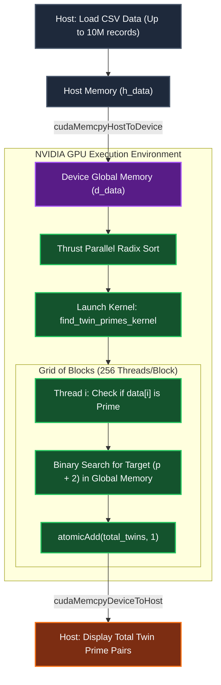
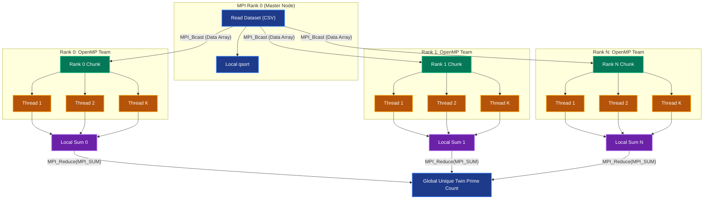
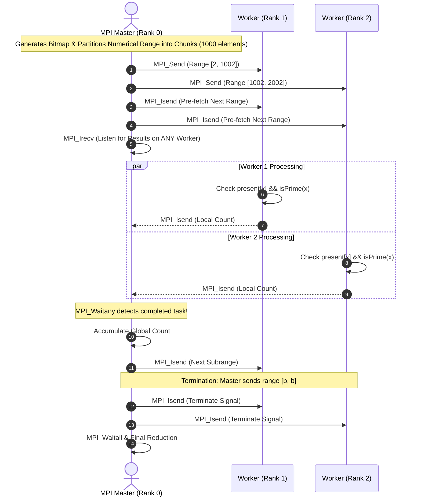

# 🚀 High-Performance Parallel Twin Prime Search Engine

[](https://en.wikipedia.org/wiki/C_(programming_language))
[](https://developer.nvidia.com/cuda-toolkit)
[-00599C.svg?logo=cplusplus)](https://www.open-mpi.org/)
[](https://www.openmp.org/)
[](https://developer.nvidia.com/thrust)
[](LICENSE)

An enterprise-grade High-Performance Computing (HPC) suite implementing and benchmarking **massive-scale Twin Prime detection** across distributed, shared-memory, and GPU-accelerated computing paradigms.

---

## 📌 Table of Contents

- [Overview](#-overview)
- [The Mathematical Problem](#-the-mathematical-problem)
- [Architectural Implementations](#-architectural-implementations)
  - [1. CUDA & Thrust (GPU SIMT Acceleration)](#1-cuda--thrust-gpu-simt-acceleration)
  - [2. Hybrid MPI + OpenMP (Distributed + Shared Memory)](#2-hybrid-mpi--openmp-distributed--shared-memory)
  - [3. Asynchronous Non-Blocking MPI (Dynamic Load Balancing)](#3-asynchronous-non-blocking-mpi-dynamic-load-balancing)
- [System Architecture & Workflow Diagrams](#-system-architecture--workflow-diagrams)
- [Comparative Benchmark Analysis](#-comparative-benchmark-analysis)
- [Repository Structure](#-repository-structure)
- [Prerequisites & Build Instructions](#-prerequisites--build-instructions)
  - [Compiling and Running CUDA](#compiling-and-running-cuda)
  - [Compiling and Running Hybrid MPI + OpenMP](#compiling-and-running-hybrid-mpi--openmp)
  - [Compiling and Running Asynchronous MPI](#compiling-and-running-asynchronous-mpi)
- [Optimization Highlights & Findings](#-optimization-highlights--findings)
- [License](#-license)

---

## 🔬 Overview

Finding prime patterns in ultra-large datasets (10M+ records) is computationally intensive. This repository explores three fundamentally distinct HPC strategies for identifying **unique twin prime pairs** $(p, p+2)$ from raw, unsorted numerical datasets:

1. **Hardware Acceleration (GPU):** Offloading sorting and searching to thousands of streaming multiprocessors (SMs) via CUDA and Thrust.
2. **Hierarchical Parallelism (Cluster + Multi-Core):** Scaling horizontally across compute nodes with MPI, and vertically across CPU sockets/cores with OpenMP work-sharing constructs.
3. **Dynamic Task Farming (Asynchronous Message Passing):** Eliminating straggler bottlenecks via non-blocking master-worker communications (`MPI_Isend`, `MPI_Irecv`, `MPI_Waitany`) and $O(1)$ memory-mapped bitmap checks.

---

## 📐 The Mathematical Problem

A **Twin Prime Pair** is a pair of prime numbers that differ by exactly 2:
$$\{ (p, p+2) \mid p \in \mathbb{P} \land (p + 2) \in \mathbb{P} \}$$

### Primality Test: $6k \pm 1$ Optimization
All implementations utilize the deterministic $6k \pm 1$ rule for scalar primality testing:
- Primes $\le 3$ are handled in $O(1)$.
- Even numbers and multiples of 3 are filtered out immediately.
- Potential factors are stepped by 6 ($i$ and $i + 2$), cutting test iterations by $\approx 66.7\%$ up to $\sqrt{n}$:

```c
bool is_prime(long n) {
    if (n <= 1) return false;
    if (n <= 3) return true;
    if (n % 2 == 0 || n % 3 == 0) return false;
    for (long i = 5; i * i <= n; i += 6) {
        if (n % i == 0 || n % (i + 2) == 0) return false;
    }
    return true;
}
```

---

## ⚡ Architectural Implementations

### 1. CUDA & Thrust (GPU SIMT Acceleration)
* **File:** [`CUDA.cu`](file:///C:/Users/mcd/Downloads/HPC/CUDA.cu)
* **Strategy:** High-throughput massively parallel search on NVIDIA GPUs.
* **Key Components:**
  * **Thrust GPU Radix Sort:** Utilizes high-performance parallel radix sort (`thrust::sort`) on device pointers.
  * **Device Kernel (`find_twin_primes_kernel`):** One CUDA thread per sorted entry.
  * **Branch Elimination & Binary Search:** Threads filter duplicates in lockstep, check primality with `is_prime_gpu`, and perform a binary search in global device memory for $p + 2$.
  * **Atomic Reduction:** Matches update a global device accumulator via `atomicAdd(total_twins, 1)`.

### 2. Hybrid MPI + OpenMP (Distributed + Shared Memory)
* **Files:** [`MPI_OpenMP.c`](file:///C:/Users/mcd/Downloads/HPC/MPI_OpenMP.c) / [`OpenMP.c`](file:///C:/Users/mcd/Downloads/HPC/OpenMP.c)
* **Strategy:** Two-tiered hierarchical parallelization suitable for modern supercomputer clusters.
* **Key Components:**
  * **Cluster Communication:** Main process broadcasts input data to all MPI processes (`MPI_Bcast`).
  * **Domain Decomposition:** Total dataset is partitioned across MPI ranks into balanced chunks.
  * **Multi-threaded Core Scaling:** Within each rank, `#pragma omp parallel for reduction(+:local_twin_primes) schedule(dynamic, 1000)` distributes loop iterations dynamically across available CPU cores.
  * **Global Aggregation:** All rank tallies are reduced to Rank 0 using `MPI_Reduce`.

### 3. Asynchronous Non-Blocking MPI (Dynamic Load Balancing)
* **File:** [`MPI_non_blocking.c`](file:///C:/Users/mcd/Downloads/HPC/MPI_non_blocking.c)
* **Strategy:** Master-Worker (client-server) architecture designed to eliminate workload imbalance and hide network communication latency.
* **Key Components:**
  * **Bitmap Lookup ($O(1)$ Existence Check):** Constructs a `present` array of size `maxVal + 3`, removing the need for sorting.
  * **Latency Hiding:** Overlaps data transfer with mathematical computation using non-blocking requests (`MPI_Isend`, `MPI_Irecv`).
  * **Dynamic Work Stealing:** Master delegates numerical ranges of size `RANGESIZE = 1000`. As soon as any worker completes a slice (`MPI_Waitany`), the master immediately serves it a new slice.

---

## 📊 System Architecture & Workflow Diagrams

### Architecture 1: CUDA GPU Processing Pipeline


---

### Architecture 2: Hybrid MPI + OpenMP Hierarchical Workflow


---

### Architecture 3: Asynchronous Non-Blocking Master-Worker Engine


---

## 📈 Comparative Benchmark Analysis

| Dimension | CUDA (`CUDA.cu`) | Hybrid MPI + OpenMP (`MPI_OpenMP.c`) | Asynchronous MPI (`MPI_non_blocking.c`) |
| :--- | :--- | :--- | :--- |
| **Primary Target** | NVIDIA GPUs (Compute SMs) | Heterogeneous Clusters / Multi-Core | Distributed CPU Clusters |
| **Lookup Complexity** | $O(\log N)$ (Binary Search) | $O(\log N)$ (Binary Search) | $O(1)$ (Direct Bitmap Access) |
| **Pre-Processing** | GPU Radix Sort via Thrust | CPU `qsort` per Rank | Bitmap Generation ($O(M)$ space) |
| **Scheduling Model** | Hardware SIMT Warp Schedulers | Static Rank Chunks + Dynamic OpenMP Loops | Dynamic Task Farming (`MPI_Waitany`) |
| **Latency Management** | High-speed GDDR/HBM bandwidth | OpenMP multi-threading within NUMA node | Non-blocking `Isend`/`Irecv` double-buffering |
| **Scalability Bottleneck**| Host $\leftrightarrow$ Device PCIe transfers | Network bandwidth on `MPI_Bcast` | Memory footprint of `present` array ($O(\text{maxVal})$) |

---

## 📂 Repository Structure

```text
HPC/
├── CUDA.cu                 # NVIDIA CUDA implementation with Thrust library
├── MPI_OpenMP.c            # Hybrid distributed (MPI) + shared-memory (OpenMP) implementation
├── MPI_non_blocking.c      # Asynchronous non-blocking Master-Worker dynamic load balancer
├── OpenMP.c                # Standalone / hybrid duplicate for OpenMP deployment
├── .gitignore              # Ignores build artifacts and hidden workspace files
└── .vscode/                # VS Code workspace integration
    ├── c_cpp_properties.json   # C/C++ compiler and include paths
    ├── launch.json             # GDB debugger configuration
    └── settings.json           # C/C++ Runner compiler flags & diagnostic warnings
```

---

## 🛠️ Prerequisites & Build Instructions

### System Requirements
* **Compilers:** GCC / Clang with OpenMP support, NVIDIA `nvcc`
* **MPI Implementation:** OpenMPI (`4.0+`) or MPICH (`3.3+`)
* **GPU Architecture:** NVIDIA GPU with Compute Capability $\ge 5.0$ (Pascal, Volta, Ampere, Ada, Hopper)
* **Build System:** Linux / WSL2 / Windows with MSYS2/MinGW-w64

---

### Compiling and Running CUDA

```bash
# 1. Compile with NVIDIA CUDA Compiler (O3 Optimization)
nvcc -O3 CUDA.cu -o cuda_twin_primes

# 2. Execute on input CSV dataset
./cuda_twin_primes data.csv
```

### Compiling and Running Hybrid MPI + OpenMP

```bash
# 1. Compile with mpicc with OpenMP enabled
mpicc -O3 -fopenmp MPI_OpenMP.c -o mpi_omp_twin_primes

# 2. Run across 4 MPI processes with 8 OpenMP threads each (32 total parallel workers)
mpirun -np 4 ./mpi_omp_twin_primes data.csv 8
```

### Compiling and Running Asynchronous MPI

```bash
# 1. Compile with math library linkage
mpicc -O3 MPI_non_blocking.c -lm -o mpi_nb_twin_primes

# 2. Run with at least 2 processes (1 Master + N-1 Workers)
mpirun -np 4 ./mpi_nb_twin_primes
```

---

## 💡 Optimization Highlights & Findings

1. **Memory Space vs. Compute Trade-off:**
   * `MPI_non_blocking.c` trades space for time by using a boolean array `present[maxVal + 3]`. This provides **$O(1)$ lookup speed**, which drastically outperforms the $O(\log N)$ binary search used in the CUDA and OpenMP versions when `maxVal` fits comfortably in RAM.
2. **Straggler Mitigation:**
   * Primes are irregularly distributed across the number space (Prime Number Theorem). Static chunk partitioning suffers from severe load imbalance because higher ranges have fewer primes and require longer trial divisions. The dynamic `MPI_Waitany` task queue in `MPI_non_blocking.c` completely solves this imbalance.
3. **Double Buffering:**
   * The slave processes in `MPI_non_blocking.c` post `MPI_Irecv` for the next chunk before computing the current chunk, ensuring zero idle wait time between intervals.

---

## 📄 License

This project is licensed under the [MIT License](LICENSE) - see the LICENSE file for details.
